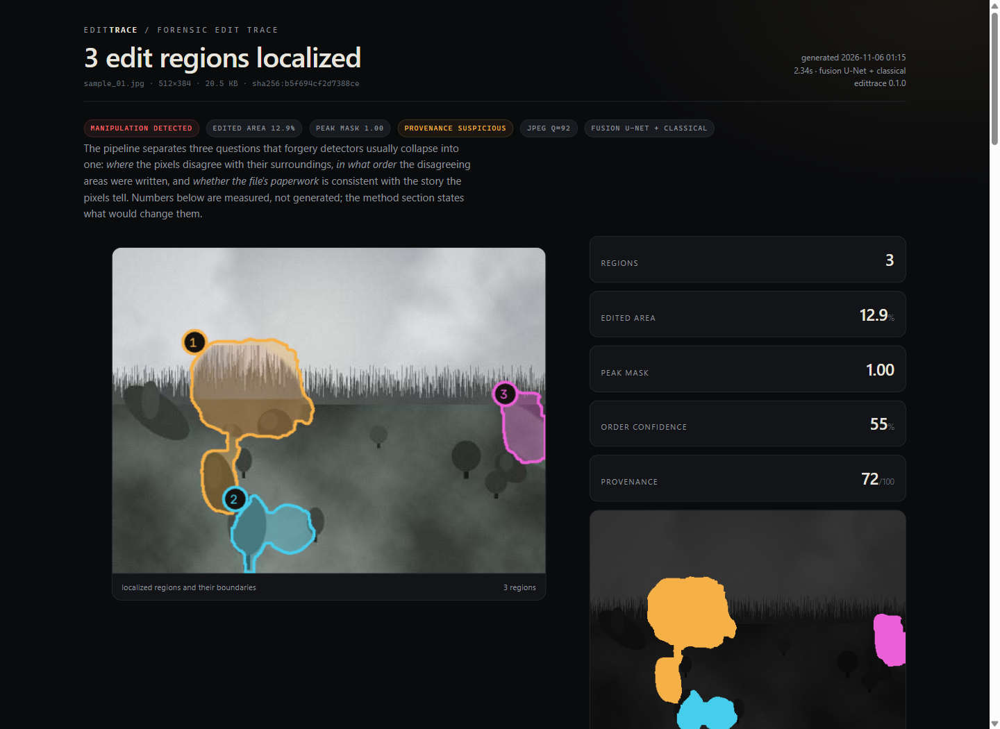

# EditTrace

**Forensic localization, edit-order reconstruction and provenance auditing for images.**

Most "AI image detectors" answer one bit: real or fake. EditTrace answers the questions an
investigator actually asks:

1. **Where** were the pixels changed, and what kind of edit was it?
2. **In what order** were those edits applied?
3. **Which clues** support each claim, and does the file's metadata agree?

It runs on CPU, needs no dataset to start, and every conclusion is emitted with the
measurement that produced it.

```bash
pip install -e .
python -m edittrace demo --n 3
```



```
[1/3] sample_00.jpg: 2 regions, order conf 0.61, prov 0.36
[2/3] sample_01.jpg: 1 region,  order conf 0.00, prov 0.84
[3/3] sample_02.jpg: 3 regions, order conf 0.44, prov 0.71
demo written to .../.out/demo
```

Each sample gets a self-contained `*.report.html` (no external assets), a machine-readable
`*.json`, and the demo writes `overview.png` with ground truth next to the inference.

---

## Why this is different

A manipulation mask alone is easy to fake and hard to trust. EditTrace treats an image as a
**scene with a history**:

| Stage | Question | Output |
| --- | --- | --- |
| Localization | which pixels disagree with their surroundings? | calibrated mask + region hypotheses |
| Typing | was it cloned, spliced, resampled or inpainted? | per-region archetype + scores |
| Ordering | which region was written first? | sequence + pairwise evidence + confidence |
| Provenance | does the container agree with the pixels? | EXIF/XMP/thumbnail/quantisation audit |
| Explanation | why should anyone believe this? | per-region evidence and channel attribution |

The ordering stage is the unusual part. It builds a **precedence graph** from four physical
cues, then topologically sorts it with cycle rejection. Pairs with no evidence are reported
as *undecided* instead of being assigned a confident-looking rank.

---

## Architecture

```
                    ┌──────────────────────────────────────────────┐
 image / EXIF ─────▶│ ingest: pixels, quant tables, EXIF, XMP, thumbs│
                    └───────────────┬────��─────────────────────────┘
                                    ▼
        ┌───────────────────────────────────────────────────────────┐
        │ 12 forensic channels @ full resolution                    │
        │ ELA · noise · JPEG ghost · block grid · CFA · resampling  │
        │ seam · HF energy · chroma · edge density                  │
        └───────────────┬───────────────────────────┬───────────────┘
                        ▼                           ▼
            18-channel U-Net (1.1M)         classical log-odds
                        └────────────┬──────────────┘
                                     ▼
                          fused mask → regions → typing
                                     │
              ┌──────────────────────┼───────────────────────┐
              ▼                      ▼                       ▼
      precedence graph        provenance audit        evidence + attribution
      (4 cues, cycle-safe)    (metadata, thumbnails)  (ablation, z-scores)
              └──────────────────────┼───────────────────────┘
                                     ▼
                         report.html + trace.json
```

---

## Method

### 1. Forensic channels

| channel | what it measures | why it separates edits |
| --- | --- | --- |
| `ela` | recompression error at the file's estimated quality | foreign pixels converge differently |
| `noise_z` / `noise_var` | local sensor-noise floor | splices import a different grain; fills are too clean |
| `ghost_min` / `ghost_spread` | JPEG ghost residual over a quality sweep | regions last quantised at another quality |
| `blockiness` | 8×8 grid energy and phase | pastes at non-aligned offsets break the lattice |
| `cfa_resid` | 2×2 colour-filter residual | rendered/resampled content lacks the host's demosaic fingerprint |
| `resample` | second-derivative autocorrelation | scaled or rotated patches leave periodic variance |
| `seam` | texture edges × statistical discontinuity | compositing seams are both at once |
| `hf_energy` | high-frequency energy | repeated saves smooth content |
| `color_shift` | local chroma deviation | colour-matched patches still drift |
| `edge_density` | gradient density | context only |

All channels are robustly normalised and kept at full resolution. The model also receives
luma, local luma mean/std, and three explicit **contrast** channels (channel minus a wide
local baseline), which let it ask "different from its surroundings?" rather than "high?".

### 2. Fusion model

`UNet(in_ch=18, width=24, depth=4)` — 1.1M parameters, GroupNorm, SiLU, bilinear decoder.
Trained with BCE (positive weight 2.2) + Dice on procedurally tampered scenes. Inference is
tiled with overlap for large images. The classical score is blended in at 0.20 weight as a
sanity anchor for out-of-distribution inputs.

### 3. Regions and typing

The mask is thresholded with hysteresis, components below 0.15% of the frame are dropped,
and each region is described by 20+ measurements inside vs. a surrounding ring. Type scores:

* **copy-move** — masked template matching on gradient magnitude (`NCC ≥ 0.9`), with the
  source location recorded;
* **resampled insert** — resampling periodicity;
* **inpaint / removal** — noise floor and HF energy both below the ring;
* **splice** — noise/ELA disagreement, JPEG ghost mismatch.

### 4. Edit ordering

For each pair `(A, B)` four cues produce a signed score in `[-1, 1]`; positive means
"A before B".

| cue | weight | reasoning | when it is available |
| --- | --- | --- | --- |
| `compression_lineage` | 0.30 | a region present before an earlier save carries that save's double-quantisation period | host shows DQ structure |
| `recompression_smoothing` | 0.24 | every extra save attenuates noise/HF/ELA; the smoother region is older | JPEG source |
| `seam_truncation` | 0.18 | an edit on top erases the underlying region's seam along the shared arc | regions within 4 px |
| `seam_blend` | 0.14 | feathered paste bleeds the top layer's noise into the shared band | regions within 4 px |
| `noise_floor` | 0.14 | foreign inserts usually raise the local noise floor | always |

Unavailable cues are dropped and weights renormalised. Edges are inserted strongest-first
and skipped if they would close a cycle (the conflict is reported). The DAG is then sorted
with Kahn's algorithm; ties break toward the more confident region. Sequence confidence is
the mean edge strength scaled by pair coverage.

This is deliberately conservative: a single contradictory cue cannot corrupt the sequence,
and an underdetermined pair stays undecided.

#### Learned precedence

Hand weights leave signal on the table, so a small logistic model is trained on directed
region pairs from synthetic scenes (ground-truth masks, known order). The feature vector is
**antisymmetric** — swapping A and B negates every component — so
`p(A before B) = 1 - p(B before A)` holds by construction. It combines the five cue values,
log-ratios of noise/HF/ELA/resampling, DQ and seam differences, area and confidence
differences, and signed edit-type indicators (18 features). At inference its margin is
blended 78/22 with the rule score. Training:

```bash
python -m edittrace train-order --scenes 160
```

The rules remain the fallback when no `precedence.npz` is present, and the pair table in
every report shows both the rule cues and the learned margin.

### 5. Provenance audit

Independent of the pixels, the container is checked for: editor software tags, XMP edit
history, embedded-thumbnail mismatch (a stale preview is strong evidence of a later edit),
non-standard quantisation tables, double-compression periodicity, trailing bytes, multiple
JPEG streams, missing camera identity, and timestamp gaps. Findings carry severity and a
combined score; the score is about the *file*, not the image content.

### 6. Evidence and attribution

Each region gets the top five measured clues, written as claims with units and effect sizes.
Channel attribution is **occlusion attribution on the scoring function**: one channel at a
time is replaced by its image mean, the score is recomputed, and the mean drop inside the
region is reported as a share. No saliency hand-waving.

---

## Results

Evaluated on held-out procedural scenes (2 edits each, seeds disjoint from training).
Full protocol and per-sample output: `edittrace/evaluate.py`, `.out/eval_*.json`.

<!-- RESULTS_TABLE -->

| metric | fusion (default) | classical fallback |
| --- | --- | --- |
| pixel IoU | **0.516** | 0.156 |
| pixel F1 | **0.648** | 0.261 |
| region precision | **0.610** | 0.246 |
| region recall | **0.792** | 0.375 |
| edit-type accuracy | **0.611** | 0.500 |
| order Kendall τ | **0.905** (n=7) | 0.333 (n=3) |
| pairwise accuracy (decided) | **0.929** | 0.667 |
| pairwise coverage | **0.556** | 0.250 |
| order confidence | 0.437 | 0.411 |
| seconds / image (CPU) | 1.10 | 0.60 |

Protocol: 12 held-out procedural scenes, two edits each, seeds disjoint from both
training runs; threshold 0.58, model weight 0.80. `n` for τ is the number of scenes
where at least two predicted regions matched ground-truth edits.

**Oracle-localization ordering.** Feeding ground-truth masks into the ordering stage
(same 12 scenes) gives **12/12 correct pairs, mean τ +1.000**. That isolates the
ordering method from the detector: when the regions are right, the precedence model is
reliable. Localization is the current bottleneck, not the ordering logic.

The learned precedence model reaches 0.919 training accuracy on 160 synthetic scenes
(seeds 800000+). Its strongest features are `log_ela_ratio` (−4.33), `log_hf_ratio`
(+2.43) and `resample_ratio` (−0.57): earlier regions carry a lower recompression
residual and less high-frequency energy, exactly the multi-save asymmetry the simulator
injects. On real files this relationship is weaker and noisier; retrain before trusting
the ranking.

### Real-image evaluation (Columbia)

Source: **Columbia Uncompressed Splicing** — 180 forged images with ground-truth masks and
184 authentic photographs, obtained from the
[ForgeryVCR mirror](https://huggingface.co/datasets/ForgeryVCR-Team/ForgeryVCR)
(`datasets/test/columbia_tp.zip`, `columbia_au.zip`). Split fixed before any tuning: every
third image is held out (60 forged / 61 authentic test); the other 120 forged / 123
authentic are used only for fine-tuning. Evaluation at max side 512, model-only, threshold
0.60 selected on the **training** split.

**Pixel-level confusion matrix**

| metric | zero-shot (synthetic ckpt) | fine-tuned on Columbia |
| --- | --- | --- |
| TP | 969,959 | 2,123,073 |
| FP | 4,082,198 | 3,046,702 |
| TN | 23,503,719 | 24,539,215 |
| FN | 3,163,548 | 2,010,434 |
| precision | 0.192 | **0.411** |
| recall | 0.235 | **0.514** |
| specificity | 0.852 | **0.890** |
| F1 | 0.211 | **0.456** |
| IoU | 0.118 | **0.296** |
| MCC | 0.080 | **0.367** |

**Image-level confusion matrix** (does the image contain a detected edit?)

| | zero-shot | fine-tuned |
| --- | --- | --- |
| TP | 60 | 60 |
| FP | 61 | 41 |
| TN | 0 | 20 |
| FN | 0 | 0 |
| accuracy | 0.496 | **0.661** |
| precision | 0.496 | **0.594** |
| recall | 1.000 | 1.000 |
| specificity | 0.000 | **0.328** |
| MCC | 0.000 | **0.441** |

Mean per-image IoU on forged images improves from **0.193** to **0.391** (median 0.383).
The zero-shot model fires on every authentic image, which is the honest signature of a
synthetic-to-real domain gap; the fine-tune recovers usable specificity but still leaves
false regions on a third of clean photos.

**COVERAGE (copy-move).** Zero-shot pixel IoU 0.056 and image MCC 0.000; fine-tuning
collapsed. Copy-move duplicates inherit the host's noise and compression statistics, so
the channels this model relies on have almost nothing to see. This is reported as a
limitation rather than hidden.

Reproduce:

```bash
python scripts/finetune_real.py --dataset columbia --steps 200 --size 320
python scripts/tune_threshold.py --dataset columbia --per-class 12
python scripts/eval_real.py --dataset columbia --split test --max-side 512 \
  --model edittrace/weights/edittrace_real.pt --model-weight 1.0 --threshold 0.60
```

Notes on the numbers:

* The benchmark is synthetic by construction. It measures whether the *pipeline* works, not
  whether it generalises to a specific camera. See limitations.
* Ordering is scored only on samples where at least two predicted regions matched ground
  truth edits; `n` is reported because it is small.
* The classical baseline is included to show what the learned fusion adds, and because it is
  the fallback when no checkpoint is present.

---

## Training

Cold start needs no data at all:

```bash
python -m edittrace train --steps 400 --batch 6 --size 192
```

This trains on procedurally rendered landscapes with splice / clone / inpaint edits,
multi-session JPEG saves, feathered blends, and resampling. It takes ~13 minutes on a
12-core CPU and produces a ~4.4 MB checkpoint.

### Real data

The same loop accepts any folder of photographs as host/donor material:

```bash
# Kaggle: 101 real + 101 spliced wildlife photos with masks
pip install kaggle
# put kaggle.json in %USERPROFILE%\.kaggle\
python -m edittrace fetch kaggle-splicing --out data/raw
python -m edittrace train --data data/raw --steps 600
```

Other useful corpora and their trade-offs:

| dataset | size | note |
| --- | --- | --- |
| [Kaggle splicing](https://www.kaggle.com/datasets/prajnar3/image-forgery-detection-dataset-splicing) | 202 pairs | smallest useful real set, masks included |
| [CASIA v2](https://github.com/namtpham/casia2groundtruth) | ~12k | standard benchmark, improved masks |
| [COVERAGE](https://github.com/wenbihan/coverage) | 100 pairs | copy-move focused, small objects |
| [Columbia](https://www.ee.columbia.edu/ln/dvmm/downloads/authsplcuncmp/) | 180 pairs | uncompressed, isolates splice cues |
| [DEFACTO](https://defactodataset.github.io/) | ~230k | realistic, large, instance masks |

`edittrace fetch <name>` prints access instructions for the gated ones.

### Training data used for the shipped checkpoints

Nothing in the evaluation split was used for training or threshold tuning.

| artifact | data | scale |
| --- | --- | --- |
| `edittrace_unet.pt` | procedural scenes (splice / clone / inpaint, multi-save JPEG) | 400 steps, 192 px, seeds 1000+ |
| `precedence.npz` | procedural scene pairs with known edit order | 160 scenes / 160 pairs, seeds 800000+ |
| `edittrace_real.pt` | Columbia **train split** (106 forged + masks, 109 authentic) | 200 steps, 320 px, balanced crops, JPEG augmentation |
| synthetic evaluation | held-out procedural scenes | seeds 50000–50011 |
| real evaluation | COVERAGE **test split** (34 forged + 34 authentic) | every 3rd image, fixed before tuning |

COVERAGE is distributed for research; obtain it from the original authors or the
[ForgeryVCR mirror](https://huggingface.co/datasets/ForgeryVCR-Team/ForgeryVCR) and check
its licence before redistribution.

```bash
# real-image fine-tuning + evaluation (COVERAGE layout)
python scripts/finetune_real.py --root data/real --steps 180 --size 320
python scripts/eval_real.py --root data/real --split test --max-side 512
```

---

## CLI

| command | purpose |
| --- | --- |
| `edittrace analyze IMG…` | report + JSON for one or more images/directories |
| `edittrace demo` | generate tampered samples, analyze, write overview + reports |
| `edittrace synth` | export tampered images, masks and truth JSON |
| `edittrace train` | train the fusion U-Net (procedural or `--data`) |
| `edittrace train-order` | train the learned precedence model |
| `edittrace eval` | quantitative evaluation on held-out scenes |
| `edittrace fetch` | dataset acquisition help |

Useful flags: `--no-model` (classical only), `--threshold`, `--model PATH`, `--out DIR`.

## Output

* `report.html` — self-contained, base64 images, embedded JSON, print-friendly.
* `trace.json` — regions, stats, evidence, pair scores, order, provenance, config.
* `overview.png` (demo) — ground truth vs inference vs mask.

---

## Limitations

* **Ordering needs preserved history.** A lossless final save, screenshot, or aggressive
  denoise destroys the compression cues. The pipeline then reports low confidence or
  undecided pairs — that is the intended behaviour, not a bug.
* **Copy-move inherits the host's statistics.** Noise-based localization is blind to it;
  only texture matching catches it, and matching fails under rotation or heavy scaling.
* **The shipped checkpoint is trained on procedural scenes.** It transfers imperfectly to
  camera-native files: zero-shot on Columbia it localises real splices at pixel IoU 0.118 but
  flags every authentic image at least once (image-level specificity 0). Use
  `edittrace/weights/edittrace_real.pt` (fine-tuned on real splices) or fine-tune on your own
  domain before operational use.
* **Copy-move is a different problem.** COVERAGE (copy-move) is nearly invisible to
  noise/compression cues: zero-shot pixel IoU 0.056. The clone detector can find duplicated
  texture, but dense localisation of same-sensor duplicates remains an open weakness.
* **Provenance is not intent.** A consistent file can still be manipulated; an inconsistent
  file can be a legitimate export.
* **Small regions are hard.** Below ~0.3% of the frame, the statistics used here are too
  noisy to localise reliably.

## Ethics

This is an analysis aid for research, journalism verification and forensics education. It is
not proof of manipulation, and it should not be the sole basis for accusing anyone. Report
confidence and undecided pairs are there to be read.

## Repository layout

```
edittrace/
  forensics/     ELA, noise, JPEG ghost/DQ, CFA, resampling, seams, fusion stack
  models/        U-Net, tiled inference, synthetic dataset, training loop
  regions/       mask → components → descriptors → type classification
  ordering/      pairwise cues + cycle-safe topological sort
  provenance/    EXIF/XMP/thumbnail/quantisation audit
  explain/       evidence strings, ablation attribution, HTML report
  synth.py       procedural scenes + tamper simulator with ground truth
  evaluate.py    pixel/region/type/order metrics
  cli.py         analyze · demo · synth · train · eval · fetch
tests/           stdlib unittest suite (18 tests, ~5 s)
```

## Tests

```bash
python -m unittest discover -s tests -v
```

Covers synthesis, feature ranges, region extraction, cycle handling, Kendall tau, provenance
flags, report rendering, and a full pipeline smoke test.
